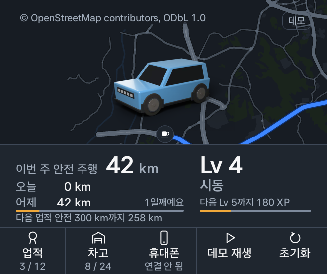
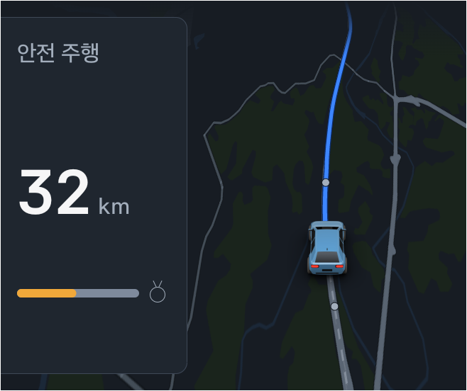
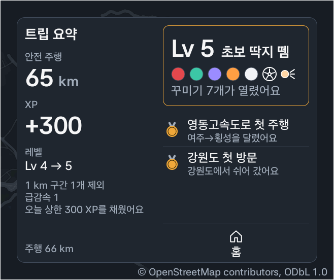
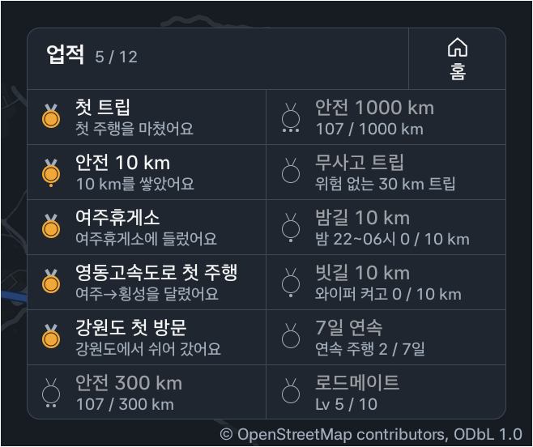
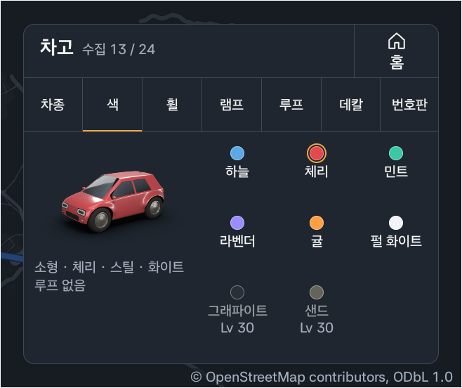
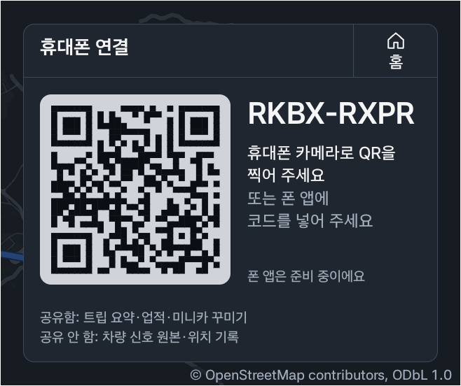

# 오도 (ODO)

**안전하게 달린 거리와 내 차로 가 본 곳이 미니카의 성장으로 쌓이는 드라이버 RPG.**
Pleos Connect(Android Automotive OS) 차량 신호로 트립을 자동으로 시작·종료하고, 1 km 구간마다 안전 XP를 판정하며, 주행 중에는 앱 스스로 터치를 막는다.

현대자동차그룹 차량용 앱 개발 공모전(Code your App into Pleos App Market) 출품작 · 팀 무지무지무지

## 화면

아래 APK를 Pleos Connect 에뮬레이터에 설치해 시나리오 재생으로 찍었다. 멀티윈도우 오른쪽 창(658×552 px)의 앱 화면만 잘랐고, 데모 프로필이라 개인정보는 없다.

| 홈 (정차) | 글랜스 (주행 중) |
|---|---|
|  |  |
| 북쪽이 위인 오프라인 드라이브 맵 위에 내 미니카(3D 렌더). 이번 주 안전 km·레벨·다음 업적, 아래 키 열(업적·차고·휴대폰·데모 재생·초기화) | 진행 방향이 위로 오게 58° 기울인 지도에 내 차와 모의 미니카 점 2개. 숫자 1개(오늘 안전 km)와 다음 업적 게이지 1개만 보이고 터치는 막힌다 |
| **트립 요약 (정차 직후)** | **업적** |
|  |  |
| 안전 km·XP → 레벨 → 업적 순서로 세 박자에 걸쳐 뜬다. 급감속·제외 구간 같은 위험 기록은 정차 후 이 화면에서만 보인다 | 12개가 모두 보이고, 연 업적은 한 일을, 남은 업적은 조건이나 진행도(예: 107 / 300 km)를 보여 준다 |
| **차고** | **휴대폰 연결** |
|  |  |
| 차종 5종(소형·중형·대형·세단·2륜)과 색·휠·램프·루프·데칼·번호판 탭. 잠긴 항목에는 여는 레벨이 적혀 있다 | 기기 안에서 그린 QR 코드와 8자 코드, 공유 범위 두 줄. 1차는 폰 쪽 화면이 목업이다 |

## APK

- 저장소 [`apk/무지무지무지_오도_release.apk`](apk/무지무지무지_오도_release.apk) (release 빌드, 서명됨, 약 43 MB)
- 이 APK는 **시나리오 재생 모드**(`USE_FAKE_SIGNALS=true`)로 빌드했다. 에뮬레이터에 차량 신호를 따로 넣지 않아도 시연 흐름 전체를 볼 수 있다. 단, 에뮬레이터의 실제 기어는 P(기본값)여야 한다(아래 '시나리오 재생 방법').

## 실행 방법

### APK로 바로 실행

```bash
adb install -r -g apk/무지무지무지_오도_release.apk
adb shell am start -n com.mujimujimuji.odo/.MainActivity
```

`-g`는 차량 속도·Pleos 차량 신호·위치·TTS 권한을 설치 때 한 번에 준다. 앱 서랍의 **오도** 아이콘으로 실행해도 된다.

다른 키로 서명한 빌드(예: 소스에서 만든 debug)가 이미 깔려 있으면 서명이 달라 `-r` 설치가 실패한다. 그때는 `adb uninstall com.mujimujimuji.odo`로 먼저 지운다. 데모 프로필은 첫 실행 때 다시 만들어진다.

설치된 APK의 권한 목록에는 `INTERNET`도 보인다. 앱 매니페스트에는 없고, Pleos TextToSpeech·SpeechToText SDK(3.3.1)의 라이브러리 매니페스트가 빌드 때 병합해 넣은 것이다. 앱 코드(`app/src/main/java`)에는 네트워크 호출이 없고, 지도 서버·타일도 부르지 않는다.

### 소스에서 빌드

```bash
./gradlew testDebugUnitTest          # 단위 테스트 214개 (engine·sim·cosmetic·drive·platform, ui/components·map·summary·theme·vehicle·text)
./gradlew assembleDebug              # app/build/outputs/apk/debug/
./gradlew assembleRelease            # app/build/outputs/apk/release/
```

- JDK 17, Android SDK 34(compileSdk·targetSdk 34)가 필요하다. Pleos Connect SDK는 공개 Maven 저장소(`https://nexus-playground.pleos.ai/repository/maven-releases/`)에서 받는다. 이 주소는 `settings.gradle.kts`에 이미 들어 있고 계정 설정은 필요 없다. 에뮬레이터는 [개발 환경 설정 문서](https://document.pleos.ai/docs/connect/guide/getting-started/application-development/setup-connect-sdk-emulator)를 따라 준비한다(아래 '에뮬레이터 준비').
- release 서명 정보는 저장소에 없다. 루트에 `keystore.properties`(`storeFile`, `storePassword`, `keyAlias`, `keyPassword`)를 두면 그 키로 서명하고, 없으면 서명 없이 빌드된다. 서명 키 없이 만든 release APK는 설치되지 않는다. 키가 없으면 debug 빌드(`assembleDebug`)를 쓴다. debug 빌드는 Android 기본 debug 키로 서명된다.

## 테스트 환경

| 항목 | 값 |
|---|---|
| 에뮬레이터 | Pleos Connect 에뮬레이터 `release_connect_v2.1.0` (Android 14, API 34, arm64-v8a) |
| 화면 | 1024×768, 160 dpi. 앱은 멀티윈도우 오른쪽 창(658×552 px)에서 동작 확인 |
| 빌드 | AGP 8.7.3, Gradle 8.11.1, Kotlin 2.0.21, minSdk 28, targetSdk 34 |
| Pleos SDK | Vehicle 2.3.2, FusedLocation 1.1.3, NaviHelper 3.0.5, TextToSpeech 3.3.1, SpeechToText 3.3.1(의존성만, 1차 미사용) |

### 에뮬레이터 준비 (Apple silicon Mac 기준)

Windows·Linux에서는 [개발 환경 설정 문서](https://document.pleos.ai/docs/connect/guide/getting-started/application-development/setup-connect-sdk-emulator)의 운영체제별 안내를 따른다.

1. Android Studio의 **SDK Manager**에서 **SDK Update Sites** 탭에 사이트를 더한다. 이름은 `Pleos Connect System Image`, 주소는 Mac용 `https://nexus-playground.pleos.ai/repository/raw-releases/connect-avd/2.x/crp-arm64-sys-img.xml`이다.
2. **SDK Platforms** 탭에서 **Show Package Details**를 켜고 Android API 34 아래의 Pleos Connect 시스템 이미지를 설치한 뒤 Android Studio를 다시 시작한다.
3. **Device Manager**에서 Form Factor **Automotive**의 **Pleos Connect v2.1.0**을 고르고, 시스템 이미지는 API 34의 **Pleos Connect v2.1.0 APIs**를 고른다. 고급 설정에서 Default boot는 **Cold**, RAM은 **4 GB**로 둔다.
4. 에뮬레이터를 켠 뒤 `adb forward tcp:8088 tcp:8088`을 실행하고 브라우저에서 `http://127.0.0.1:8088/`을 열면 Virtual Console(기어·속도 조작)이 뜬다([Virtual Console 안내](https://document.pleos.ai/docs/connect/guide/getting-started/application-development/use-vehicle-emulator)).

### `USE_FAKE_SIGNALS` 전환

빌드 속성 `useFakeSignals`가 `BuildConfig.USE_FAKE_SIGNALS`로 들어간다. 기본값은 `true`다.

| 모드 | 빌드 명령 | 신호 출처 |
|---|---|---|
| 시나리오 재생 (기본, 제출 APK) | `./gradlew assembleRelease` | `assets/scenarios/gangneung_trip.json`. 시스템 운전 제한(CarUxRestrictions)은 이 모드에서도 따른다 |
| 실제 SDK | `./gradlew assembleDebug -PuseFakeSignals=false` | Vehicle(기어·벨트·와이퍼·주행거리, 지시등은 구독만), NaviHelper(제한속도, 안내 중일 때), AAOS 속도, FusedLocation, CarUxRestrictions |

실제 SDK 모드 APK는 저장소에 없어 소스에서 빌드한다. 서명 키 없이 바로 설치되도록 debug로 빌드하며, 결과는 `app/build/outputs/apk/debug/app-debug.apk`다. 제출 APK(release)가 이미 깔려 있으면 서명이 달라 `-r` 설치가 실패하므로, 위 'APK로 바로 실행'의 안내대로 `adb uninstall com.mujimujimuji.odo`로 먼저 지운 뒤 `adb install -r -g app/build/outputs/apk/debug/app-debug.apk`로 설치한다.

실제 SDK 모드에서 에뮬레이터에 신호를 넣는 방법:
- 기어·속도: 에뮬레이터 Virtual Console 화면의 기어·속도 조작
- 위치: `adb emu geo fix <경도> <위도>`
- 안전벨트: 에뮬레이터는 운전석 벨트를 미체결로 알려 주고, Virtual Console에는 벨트를 채우는 조작이 없다. 그래서 실제 SDK 모드로 달리면 트립 요약에 안전벨트 미착용이 잡히고, 그렇게 판정된 1 km 구간은 XP에서 빠진다. XP가 쌓이는 흐름은 시나리오 재생 모드에서 본다.
- 권한: `-g` 없이 설치해 속도·위치 권한을 거절했다가 나중에 허용했으면, 앱을 완전히 끄고(`adb shell am force-stop com.mujimujimuji.odo`) 다시 연다. 그 전에는 속도·위치가 들어오지 않는다.
- 속도 권한을 끝내 거절하면 기어로 터치 잠금과 트립 시작·종료는 되지만 속도는 들어오지 않는다. 이때는 주행거리 신호도 반영하지 않는다(속도 없이 거리만 쌓이는 오판을 막기 위해서다). 그래서 트립 거리와 XP가 0으로 남는다. logcat `OdoSpeed`에 원인이 남는다.

### Pleos SDK 활용과 1차 범위

| SDK·API | 어댑터 | 앱에서 하는 일 | 1차 상태와 에뮬레이터 확인 |
|---|---|---|---|
| Vehicle SDK 2.3.2 | `platform/pleos/PleosVehicleSignals.kt` | 기어 → 주행 상태, 터치 잠금, 트립 시작·종료. 운전석 벨트 → 미착용 주행 이벤트. 와이퍼 → 우천 보너스(×1.5). 주행거리 → 1 km 구간 거리. 방향지시등은 구독만 한다 | 구현. 기어 P·D·N 수신 확인. 에뮬레이터는 모든 좌석 벨트를 미착용(false)으로 보낸다. 그래서 실제 SDK 모드로 달린 1 km 구간은 벨트 미착용으로 XP에서 빠진다(위 안전벨트 항목). 주행거리는 0에 머물러 속도 적분으로 거리를 센다 |
| AAOS Car API (`PERF_VEHICLE_SPEED`) | `platform/pleos/CarSpeed.kt` | 속도 → 주행 판정(속도 > 0), 1 km 구간 거리(속도 적분), 급가속·급감속 판정 | 구현. Virtual Console로 넣은 차속 수신 확인 |
| AAOS `CarUxRestrictions` | `platform/pleos/CarUxDrivingRestriction.kt` | 시스템 운전 제한이 걸리면 터치 잠금 | 구현. 에뮬레이터의 시스템 값은 기어 P에서 `DO: false UxR: 0`, D에서 `DO: true UxR: 80`이며, 이 값은 N으로 정차해 있는 동안에도 유지됐다 |
| FusedLocation SDK 1.1.3 | `platform/pleos/PleosLocationSource.kt` | 위치 → 지오펜스 업적(기기 안에서 판정), 지도 위 내 차 위치 | 구현. `adb emu geo fix` 반영 확인 |
| NaviHelper SDK 3.0.5 | `platform/pleos/PleosNaviBridge.kt` | 제한속도 수신 → 과속 판정(값이 없으면 생략) | 수신 코드 구현, 에뮬레이터 값은 미확인. 목적지 전송은 2차 범위 |
| TextToSpeech SDK 3.3.1 | `platform/pleos/PleosVoice.kt` | 오늘 상한 도달과 정차 중에 연 업적을 음성 한 문장으로 알림(주행 중에는 10분에 2회까지) | 구현(ON_DEVICE 모드). `Locale.KOREA`(ko-KR)로 에뮬레이터 재생 확인. Pleos 엔진이 초기화에 실패하거나 한 문장을 소리 내기 전에 실패하면 Android 기본 TTS로 대신 읽는 코드가 있지만, 이 에뮬레이터에는 기본 TTS 엔진이 없어 확인하지 못했다 |
| SpeechToText SDK 3.3.1 | 없음 | 음성 명령 3종 | 1차 미사용(의존성만 포함). 2차 범위 |

시나리오 재생 빌드에서도 음성은 Pleos TextToSpeech SDK(ON_DEVICE)로 내고, 시스템 운전 제한(CarUxRestrictions)이 걸리면 화면을 잠근다. 재생으로 바뀌는 것은 기어·속도·위치 같은 차량 신호의 출처다. 그 밖에 데모 프로필, 홈의 **데모 재생**·**초기화** 키, 오른쪽 위 **데모** 칩은 이 빌드에만 있다.

1차에 없는 것(2차 범위):

- 서버와 실제 폰 앱(아래 '휴대폰 연결 (1차)')
- 로드 레이더 통신(1차 주행 화면에는 모의 미니카 점 2개만 띄운다)
- 손 흔들기
- 친구·만남
- 홈존(자주 주차하는 곳) 학습
- NaviHelper 목적지 전송

운전자 구분 같은 그 밖의 한계는 아래 '알려진 한계 (1차)'에 모았다.

### 시나리오 재생 방법

시작 전에 에뮬레이터의 실제 기어가 P(Virtual Console 기본값)인지 확인한다. 이 APK도 시스템 운전 제한(CarUxRestrictions)을 따르므로, 기어가 P가 아니면(예: D) 화면이 잠길 수 있고 그러면 **데모 재생**을 누를 수 없다. 그때는 Virtual Console에서 기어를 P로 돌린다.

1. 앱을 열면 데모 프로필(레벨 4, 이번 주 안전 42 km, 업적 3/12)이 들어 있다. 홈 위에는 북쪽이 위인 드라이브 맵과 내 미니카(3D 렌더)가 보인다. 처음 연 날이 지났거나 데모를 이미 돌린 설치본이면 먼저 홈 아래 키 열의 **초기화**를 눌러 데모 프로필로 되돌린다(`adb install -r`은 앱 데이터를 남긴다).
2. 홈 아래 키 열의 **데모 재생**을 누르면 여주 → 횡성휴게소 영동고속도로 주행(약 66 km, 실제 약 40분)과 휴게소 정차 11분을 20배속으로 재생한다(전체 약 2분 반). 휴게소 도착까지 약 2분 걸린다.
   - 기어 D가 되면 화면이 글랜스 모드(진행 방향이 위인 지도 장면 + 숫자 1개 + 게이지 1개)로 바뀌고 터치가 막힌다.
   - 안전 30 km에서 TTS "안전 주행 30 km, 오늘 상한을 채웠어요."
   - 45 km 지점에서 급감속 1회. 주행 중 화면에는 아무 표시도 하지 않는다.
3. 휴게소에서 기어 P가 되면 트립 요약이 세 박자(안전 km·XP → 레벨 5 → 업적)로 뜬다: 안전 65 km, +300 XP, 레벨 5, "영동고속도로 첫 주행", "1 km 구간 1개 제외". 화면을 탭하면 남은 박자를 건너뛴다.
4. 그대로 두면 휴게소 체류 10분(재생 기준 약 30초) 뒤 "강원도 첫 방문" 업적이 열리고 TTS가 나온다. 홈에 있으면 알림 1줄로도 보인다.
5. **홈** → **차고**의 **색** 탭에서 레벨 5로 열린 색 5종(체리·민트·라벤더·귤·펄 화이트) 중 하나를 고르면 미니카 색이 바뀐다. 같은 화면에 차종(소형·중형·대형·세단·2륜)·휠·램프·루프·데칼·번호판 탭이 있고, 잠긴 항목에는 여는 레벨이 적혀 있다.
6. 다시 보려면 먼저 **초기화**를 누른다. 데모 프로필로 돌아가고, 고른 색·차종과 휴대폰 연결도 처음으로 돌아간다. 같은 날 초기화 없이 **데모 재생**을 다시 누르면 그날의 두 번째 트립이 된다. 오늘 상한 300 XP와 두 업적이 이미 차 있어 요약은 +0 XP(상한을 채웠다는 줄)·레벨 그대로이고, 음성 없이 주행만 재생된다.
7. 시나리오 재생 빌드에서는 오른쪽 위 **데모** 칩을 길게 누르면 야간/주간 테마를 강제로 바꿀 수 있다(기본은 시계 기준 18:30~06:30 야간). 주행 중에는 테마가 바뀌지 않는다.

TTS가 나간 기록은 `adb logcat -s OdoVoice`로 볼 수 있다.

> 에뮬레이터 참고: 시스템 앱 `ai.umos.drivingview`가 반복해서 죽은 뒤 화면 입력을 가로채 터치가 안 먹는 경우가 있다. 그럴 때 `adb shell am force-stop --user 10 ai.umos.drivingview`를 실행하면 된다.

## 구조

```
app/src/main/java/com/mujimujimuji/odo/
  platform/   Pleos SDK 어댑터 (SDK import는 여기서만) · pleos/ 실제 구현 · fake/ 시나리오 재생
  engine/     순수 Kotlin 판정 로직: 주행 상태, 1 km 구간, 위험 이벤트, XP·상한·연속 기록, 레벨, 업적
  data/       Room (프로필, 트립, 업적)
  drive/      신호 → 엔진 → 저장·음성·화면 상태
  ui/         Compose 화면: home(홈), glance(주행), summary(트립 요약), profile(업적·차고), phonelink(휴대폰 연결)
              map(드라이브 맵: 경로 주변 오프라인 지도), vehicle(3D 미니카 합성), components, text(조사 처리), theme(색·글자·간격 토큰, 밤/낮)
  cosmetic/   차종·색·루프 카탈로그와 로드아웃
  sim/        데모 시드
app/src/main/assets/
  scenarios/  데모 시나리오 JSON · map/corridor.json 오프라인 지도 · minicar/ 미니카 WebP 레이어
tools/
  scenario/   시나리오 JSON 생성 · map/ OSM 추출→경로 주변 지도 변환 · minicar/ Blender 미니카 렌더
  audio/      이어콘 합성 · design/ 색 대비표 계산 · phone-mockup/ 폰 쪽 목업(글꼴은 내려받기, 저장소 제외)
```

모든 임계값은 `engine/Thresholds.kt`, XP·레벨 표는 `engine/LevelTable.kt`에 있다.

코드 주석의 '설계서 §N'은 `docs/design-spec.md`의 절 번호를 가리킨다.

연속 기록 보너스(`engine/XpCalculator.kt`의 `StreakRules`): 하루 1 km 이상 안전 주행한 날이 이어지면 연속 일수가 1씩 늘고, 하루라도 빠지면 다시 1일부터 센다. 연속 일수가 7의 배수인 날(7·14·21일째…)마다 +50 XP, 30의 배수인 날(30·60일째…)마다 +300 XP를 그날 첫 안전 1 km 구간에서 준다. 이 보너스는 일일 상한(300 XP) 밖이라 상한을 채운 날에도 더해지고, 그 트립의 XP에 들어간다. 주행 중에는 화면·음성으로 알리지 않고, 트립 요약의 상한 캡션 자리에 따로 적는다(`TripSummary.streakBonusXp`. 예: "연속 기록 보너스 +50 XP 포함", 상한도 채웠으면 "상한 300 XP + 연속 보너스 50 XP").

## 안전·프라이버시 원칙

- 기어 D/R 또는 속도 > 0이면 앱의 모든 터치를 막는다. 트립 중 기어 N으로 멈춰도 잠금을 유지하고, 기어 P가 되면 바로 푼다(기어 신호가 없으면 속도로만 판정한다). 시스템 운전 제한(CarUxRestrictions)이 걸려 있을 때도 막는다. 이 잠금을 끄는 설정은 없다.
- 주행 중에는 숫자 1개, 게이지 1개, 드라이브 맵 장면(내 차 + 모의 미니카 점 2개)만 보인다. 문단·목록·버튼은 없다(글자는 '안전 주행' 라벨과 단위 km뿐). 위험 이벤트(종류·횟수)와 XP에서 빠진 1 km 구간 수는 정차 후 트립 요약에서만 보여 준다. 매니페스트에 주행 중 사용 선언(`distractionOptimized`)을 해 두어, 주행 중에도 시스템이 앱을 가리지 않고 이 글랜스 화면이 보인다.
- 휴대폰 연결 화면은 정차 중에만 열리고, 주행이 시작되면 대기 중인 코드를 접고 홈으로 돌아간다.
- 주행 중 TTS는 10분에 2회, 1회 1문장.
- XP는 깎이지 않는다. 위험 이벤트가 있는 구간은 0 XP일 뿐이다.
- 차량 신호와 위치 기록은 기기 밖으로 보내지 않는다(1차 버전은 서버 통신이 없다).

## 알려진 한계 (1차)

제출 APK(시나리오 재생)의 시연 흐름에는 영향이 없다. 기획서와 다른 1차 범위와, 실제 SDK 모드에서만 드러나는 동작을 함께 적었다.

- 기어 신호를 받지 못하면(UNKNOWN) 속도로 트립을 시작하지만 끝내지는 못한다. 멈추면 터치 잠금은 풀리지만(속도로만 판정), 트립 요약과 트립 기록(이번 주·어제 합계)이 남지 않는다. 트립이 끝날 때 판정하는 업적(무사고 트립 등)과 기어 P 체류가 필요한 장소 업적도 열리지 않는다. XP와 오늘 안전 km는 남는다. 에뮬레이터에서는 기어가 정상으로 들어와 생기지 않는다. 2차에 AAOS 기어 신호(`GEAR_SELECTION`) 구독을 검토한다.
- 오도를 한 번 열어야 기록을 시작한다(자동 실행 없음).
- 주행 중 앱이 종료되면(크래시, 메모리 회수) 그 트립은 트립 요약과 이번 주·어제 합계에 들어가지 않는다. 그때까지의 XP·오늘 안전 km·업적은 남고, 다시 켜면 남은 주행은 새 트립이 된다. 백그라운드에서 계속 기록하는 서비스는 2차 범위다.
- 세이프티 스코어(최근 30일 100 km당 위험 이벤트 수를 0~100점으로 환산)는 계산식과 단위 테스트만 `engine/SafetyScore.kt`에 있고, 화면 표시는 2차 범위다.
- 음성 명령(STT 3종)은 2차 범위다. SpeechToText SDK는 의존성만 들어 있다.
- 방향지시등은 구독만 하고 사용률 보너스에는 쓰지 않는다(1차는 사용률을 셀 기준이 없다).
- 캐릭터와 의상은 1차에 없고 미니카만 꾸민다. 차종은 5종(소형·중형·대형·세단·2륜) 가운데 고른다.
- 프로필은 하나다. 같은 차를 여러 사람이 몰면 기록이 한 프로필에 합쳐진다. 운전자 구분(Pleos ID, 안 되면 시동 때 프로필 선택)은 2차 범위다.
- XP와 안전 km는 1 km 구간 단위로만 센다. 트립 끝의 1 km가 안 되는 부분은 트립 거리에는 들어가지만 XP·안전 km에는 들어가지 않고, 다음 트립으로 넘어가지도 않는다. 그래서 1 km보다 짧은 트립의 요약은 +0 XP다. 연속 기록도 그날 안전 1 km 구간이 하나 이상 있어야 이어지므로, 1 km보다 짧은 트립만 여러 번 달린 날은 세지 않는다.
- 기어 P가 2초 이어지면 트립이 끝난다. 신호 대기 중 P를 넣으면 트립이 나뉘고 요약이 뜬다. 기어 N은 트립을 이어 간다.

## 오픈소스와 데이터 출처

| 이름 | 용도 | 라이선스 |
|---|---|---|
| [OpenStreetMap](https://www.openstreetmap.org/copyright) | 데모 경로·휴게소(Nominatim 검색)·업적 좌표와 경로 주변 오프라인 지도 (© OpenStreetMap contributors). 자세한 내용은 [NOTICE.md](NOTICE.md) | ODbL 1.0 |
| [OSRM](https://project-osrm.org/) 공개 데모 서버 | 데모 경로 계산 (빌드 때만, 앱에 포함 안 됨) | BSD-2-Clause |
| [OSM Overpass API](https://overpass-api.de/) | 정차·주행 화면의 드라이브 맵에 쓰는 경로 주변 오프라인 지도 데이터 `assets/map/corridor.json` 원본 추출 (빌드 때 한 번, 스냅숏 osm_base 2026-11-09T03:48:56Z, 앱은 지도 서버·타일을 호출하지 않음) | ODbL 1.0 (데이터) |
| [ZXing core](https://github.com/zxing/zxing) 3.5.3 | 휴대폰 연결 QR 코드를 기기 안에서 그림 (네트워크 없음) | Apache 2.0 |
| [Blender](https://www.blender.org/) 4.5.9 LTS | 미니카 3D 레이어 렌더 (`tools/minicar/`, 빌드 도구로만 사용, 앱에 포함 안 됨) | GPL-2.0+ (도구), 산출물은 팀 저작 |
| [libwebp](https://chromium.googlesource.com/webm/libwebp) `cwebp` 1.6.0 | 미니카 PNG → WebP 변환 (`tools/minicar/postprocess.py`, 도구로만 사용) | BSD-3-Clause |
| [FFmpeg](https://ffmpeg.org/) | 이어콘 WAV → OGG 변환 (`tools/audio/make_earcons.py`, 도구로만 사용, 앱에 포함 안 됨) | LGPL-2.1+ 또는 GPL-2.0+ (빌드 옵션에 따름, 도구) |
| [Noto Sans CJK KR](https://github.com/notofonts/noto-cjk) Sans2.004 | 폰 목업 PNG의 한글 (`tools/phone-mockup/fetch_fonts.sh`로 내려받음, 저장소·앱에 포함 안 됨) | SIL OFL 1.1 |
| [Roboto](https://github.com/googlefonts/roboto-2) v2.138 | 폰 목업 PNG의 숫자·로마자 (위와 같음) | Apache 2.0 |
| [QR Code generator](https://github.com/nayuki/QR-Code-generator) (Project Nayuki, 파이썬 판) | 폰 목업 PNG의 QR 인코더(`tools/phone-mockup/render.py`의 `qr_matrix`). 알고리즘을 바이트 모드·버전 1~6만 남기고 줄여 옮겼다. 목업 도구에만 쓰고 앱에 포함 안 됨. 저작권·허가 문구는 [NOTICE.md](NOTICE.md) | MIT |
| [Pillow](https://python-pillow.org/) | 폰 목업 PNG 그리기(`tools/phone-mockup/render.py`), 미니카 그림자 알파 처리(`tools/minicar/postprocess.py`). 도구로만 사용 | MIT-CMU (HPND) |
| AndroidX (Core, Lifecycle, Activity, Room) | 앱 기반, 로컬 저장 | Apache 2.0 |
| Jetpack Compose, Material 3 | UI | Apache 2.0 |
| Kotlin, kotlinx.coroutines | 언어, 비동기 처리 | Apache 2.0 |
| JUnit 4 | 단위 테스트 | EPL 1.0 |
| org.json | 단위 테스트에서 시나리오 JSON 읽기 | Public Domain |
| Pleos Connect SDK | 차량 신호, 위치, 내비, 음성 | Pleos 개발자 약관 |
| Pleos SDK가 함께 가져오는 라이브러리(앱 코드는 직접 쓰지 않음): Tink 1.8.0, AndroidX Security Crypto 1.1.0-alpha06, AppCompat 1.6.1·Fragment 1.5.1·RecyclerView 1.1.0·ConstraintLayout 2.0.1 등 AndroidX, Material Components 1.10.0, Gson 2.10.1, Dagger/Hilt 2.51.1, javax.inject 1, kotlinx.serialization 1.6.3, kotlin-reflect 1.9.25, JNA 5.13.0, Error Prone annotations 2.15.0, JSR-305 3.0.2 | Pleos SDK의 전이 의존성으로 APK에 함께 들어감 | Apache 2.0. JNA만 Apache 2.0과 LGPL-2.1+ 이중 라이선스(APK에 `META-INF/AL2.0`·`META-INF/LGPL2.1` 포함). Tink·kotlin-reflect에 셰이딩된 Protocol Buffers 코드는 BSD-3-Clause, JNA 네이티브 라이브러리(`libjnidispatch.so`)에 정적 링크된 libffi는 MIT. |

앱 안 아이콘(Compose 벡터)·미니카 그림·이어콘(요약 화면 효과음 3개)은 이 저장소의 코드·스크립트로 만들었다. 런처 아이콘(`design/app_icon_512.png`, `res/mipmap-*`)은 기획서의 앱 아이콘 시안 이미지를 쓰며, 만드는 스크립트는 없다. 앱에 번들한 글꼴은 없다(시스템 글꼴 사용). `tools/phone-mockup/`의 목업 도구만 OFL·Apache 글꼴을 내려받아 쓰며 글꼴 파일은 저장소에 넣지 않는다.

## 에셋 재현

| 산출물 | 스크립트 | 비고 |
|---|---|---|
| `assets/scenarios/gangneung_trip.json` | `tools/scenario/make_gangneung_trip.py` | OSRM 경로 → 20배속 샘플 |
| `assets/map/corridor.json` | `tools/map/fetch_overpass.py` → `tools/map/build_corridor.py` | [tools/map/README.md](tools/map/README.md) |
| `assets/minicar/**` (WebP 165장) | `tools/minicar/build_minicar.py` → `postprocess.py` | [tools/minicar/README.md](tools/minicar/README.md), 두 번 실행해도 바이트 동일 |
| `res/raw/earcon_*.ogg` | `tools/audio/make_earcons.py` | 사인파 합성, 외부 음원 없음 |
| 색 대비표 (Markdown 표, 표준 출력) | `tools/design/contrast.py` | 토큰을 바꾸면 다시 실행 |
| `docs/phone-mockup/*.png` (폰 동반 화면 6장) | `tools/phone-mockup/fetch_fonts.sh` → `render.py` | [tools/phone-mockup/README.md](tools/phone-mockup/README.md), 앱 소스의 토큰·문구·미니카를 읽음, 두 번 실행해도 바이트 동일 |

### 3D 미니카 (`tools/minicar/`)

- 외부 모델·텍스처 없이 `vehicles.json`의 치수·단면 값만으로 Blender가 차종 5종(소형·중형·대형·세단·2륜)을 절차 생성한다(로프트 케이지 + Subdivision Surface). 현대차 디자인 언어에서 영감을 받은 자체 스타일라이즈드 모델이고, 엠블럼·차명·그릴은 없다. `check_names.py`가 저장소에 실제 차명 같은 금지어가 0건인지 검사한다.
- 뷰 3개(차고·휴대폰 연결의 hero 576×384 px, 글랜스 지도의 navi 256×320 px, 홈·요약 지도의 top 256×384 px)마다 레이어(접지 그림자, 흰 차체, 반사광, 투톤 루프, 스트라이프, 유리·타이어·후미등 같은 고정부, 휠 3종, 램프, 루프박스, 황금 번호판, 밤 전조등·후미등 글로 가운데 그 뷰에서 보이는 것)를 알파 PNG로 렌더한다. `postprocess.py`가 이것을 WebP 165장과 합성 정보 `compose.json`(합계 약 0.9 MB)으로 묶는다.
- 색·램프·투톤·데칼은 렌더하지 않는다. 앱(`ui/vehicle/OdoVehicle.kt`)이 흰 레이어에 Modulate·Screen 블렌드로 틴트를 얹어 합성하므로, 색을 늘려도 에셋은 늘지 않는다.
- Apple M4 CPU 기준 165장 렌더에 약 3.5분(208 s, 6스레드) 걸리고, 두 번 돌려도 PNG가 바이트까지 같다.

```sh
blender -b -t 6 --python-exit-code 1 -P tools/minicar/build_minicar.py -- --vehicle all --view all --layers all --out <렌더 폴더> --samples 128
python3 -B tools/minicar/postprocess.py --src <렌더 폴더> --cwebp <cwebp 경로>   # Pillow 필요, assets/minicar/에 씀
python3 -B tools/minicar/postprocess.py --check app/src/main/assets/minicar     # files 165/165
python3 -B tools/minicar/check_names.py                                         # 0 hits여야 한다
```

### 오프라인 지도 (`tools/map/`)

- `fetch_overpass.py`가 데모 경로(여주 → 횡성) 둘레의 OSM 데이터를 Overpass API로 한 번 받는다. `build_corridor.py`가 경로 양옆 4 km만 남기고 Douglas-Peucker 10 m로 단순화해 정수 로컬 미터 JSON(`assets/map/corridor.json`, 0.40 MB: 도로 5등급·수역·숲·시가지·강·휴게소)을 만든다. 두 스크립트 모두 표준 라이브러리만 쓰고, 이름·주소 문자열은 결과에 넣지 않는다.
- 앱은 이 파일만 읽어 기기 안에서 그린다(`ui/map/`). 정차 화면은 북쪽이 위, 글랜스는 진행 방향이 위인 58° 기울인 시점이다. 런타임에 지도 서버·타일을 부르지 않는다.
- 재현 기준 원본은 Overpass `osm_base` 2026-11-09T03:48:56Z 스냅숏(sha256 `eb979c50…`, 전체 값은 [tools/map/README.md](tools/map/README.md))이고, 이 원본으로 다시 만들면 `corridor.json`이 바이트까지 같다. 받은 원본(12 MB)은 신뢰하지 않는 데이터라 저장소 밖 빈 폴더에 두고 `python3 -I`로 읽는다.

```sh
RAW=<저장소 밖 빈 폴더>
python3 -I tools/map/fetch_overpass.py --out "$RAW/overpass_raw.json"
python3 -I tools/map/build_corridor.py --raw "$RAW/overpass_raw.json" \
  --route tools/scenario/route_yeoju_hoengseong.json --out app/src/main/assets/map/corridor.json
```

## 휴대폰 연결 (1차)

홈의 **휴대폰** 키에서 QR 코드와 8자 코드(4-4)를 보여 준다. 폰 쪽 화면은 아직 목업이다([docs/phone-mockup/](docs/phone-mockup/README.md)). 1차 빌드의 `FakePhoneLink`는 3초 뒤 연결을 자동 확인해 흐름만 시연하며, 실제 폰 앱과 서버는 2차 범위다. 1차 빌드는 연결돼도 차 밖으로 나가는 데이터가 없다. 연결 화면(연결 전·연결 후)에 적힌 공유 범위는 다음 두 줄이다([NOTICE.md](NOTICE.md)와 같은 문구).

- 공유함: 트립 요약·업적·미니카 꾸미기
- 공유 안 함: 차량 신호 원본·위치 기록
